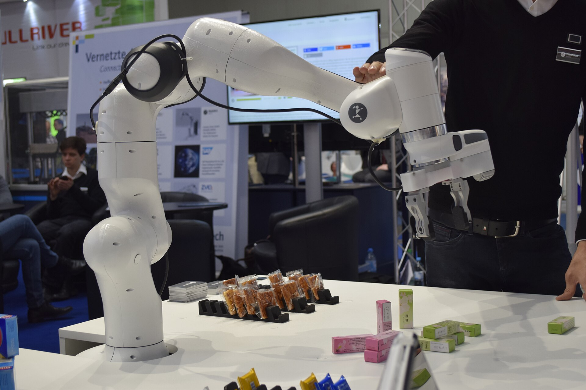
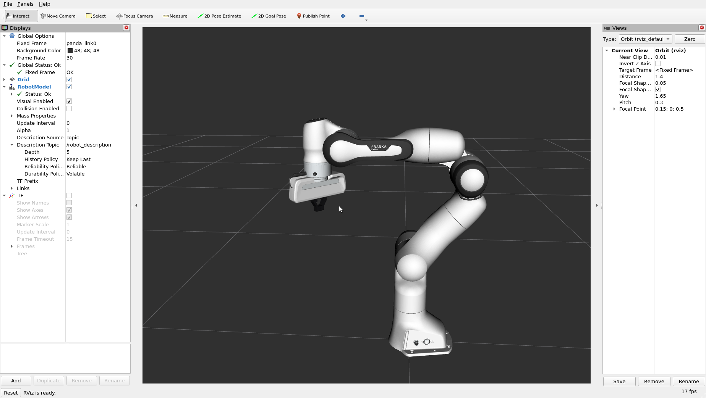

# Franka Panda — ROS 2 Simulation & Manipulation

Simulation and manipulation stack for the **Franka Emika Panda** 7-DoF arm, built with
**ROS 2 (Humble)**, **URDF/Xacro**, **Gazebo**, **ros2_control** and **MoveIt 2**.

The workspace is developed **incrementally**: each stage below is implemented, built and
verified before the next one is started.

## Preview

| Franka Emika Panda | Model in RViz |
| :---: | :---: |
|  |  |

The photo of the real robot is by *Ims*, [Wikimedia Commons](https://commons.wikimedia.org/wiki/File:Franka_Emika2.jpg),
licensed under [CC BY-SA 4.0](https://creativecommons.org/licenses/by-sa/4.0/).
The RViz screenshot shows the generated model at the ready pose.

---

## 1. Status

| Stage | Description | State |
| :--- | :--- | :--- |
| 0 | Workspace scaffolding, README, `.gitignore` | **Done** |
| 1 | Robot description (URDF/Xacro + meshes) | **Done** |
| 2 | Gazebo Sim + `ros2_control` hardware interface | **Done** |
| 3 | Controllers (joint trajectory, gripper) | **Done** |
| 4 | RViz / `robot_state_publisher` visualisation | **Done** |
| 5 | MoveIt 2 configuration (SRDF, kinematics, planners, MoveIt Setup Assistant) | Planned |
| 6 | Manipulation task nodes (e.g. pick & place) | Planned |
| 7 | Integration tests + CI | Planned |

---

## 2. Environment

Verified on the development machine:

| Component | Version | Notes |
| :--- | :--- | :--- |
| OS | Ubuntu 22.04 (Jammy) | Linux 6.8 |
| ROS 2 | Humble Hawksbill | `/opt/ros/humble` |
| Python | 3.10.12 | |
| Gazebo | Sim 6.18 (Ignition Fortress) | `ros_gz_sim`, `ign_ros2_control` |
| ros2_control | 2.54.3 | `controller_manager`, `ros2_controllers` |
| MoveIt 2 | 2.5.10 | `ros-humble-moveit` (via apt) |
| Robot description | local `franka_description` 0.1.0 | meshes and kinematics derived from upstream 1.0.1 |

### 2.1 Dependencies to install

```bash
sudo apt update
sudo apt install \
    ros-humble-moveit \
    ros-humble-moveit-ros-perception \
    ros-humble-moveit-ros-visualization \
    ros-humble-moveit-ros-planning \
    ros-humble-moveit-ros-planning-interface \
    ros-humble-moveit-configs-utils \
    ros-humble-moveit-resources-panda-moveit-config \
    ros-humble-joint-state-publisher-gui \
    ros-humble-ros2-controllers \
    ros-humble-ros-gz-sim \
    ros-humble-ros-gz-bridge \
    ros-humble-ign-ros2-control \
    ros-humble-xacro
```

> The workspace ships its own `franka_description` package.  Do **not** install
> `ros-humble-franka-description` alongside it: both provide the same ament
> resource name and the overlay would shadow one of them.  The local package
> reuses the official Franka meshes and kinematics so it stays drop-in
> compatible with upstream, while remaining easy to extend (payloads, camera
> mounts, additional grippers).

---

## 3. Workspace layout

```
franka_ws/
├── LICENSE
├── README.md
├── media/                      # README images
└── src/
    └── franka_description/     # URDF/Xacro, meshes, controllers, launch, RViz
```

Planned: `franka_moveit` (Stage 5) and `franka_manipulation` (Stage 6).

**Naming conventions**

- Packages: `franka_<domain>`
- Namespaces: `/franka`
- Frames: `base_link`, `panda_link0` … `panda_link8`, `panda_hand`, `panda_grasp_frame`
- Controllers: `panda_arm_controller` (joint trajectory), `panda_hand_controller` (gripper)

---

## 4. Build & run

### 4.1 Build

```bash
cd ~/franka_ws
source /opt/ros/humble/setup.bash
rosdep install --from-paths src --ignore-src -r -y   # first time only
colcon build --symlink-install
source install/setup.bash
```

### 4.2 Run

```bash
source install/setup.bash

# Stage 1 – inspect the model without a simulator
ros2 launch franka_description visualize_panda.launch.py

# Stage 2+ – spawned in Gazebo Sim with the controllers running
ros2 launch franka_description gazebo.launch.py

# Stage 5+ – motion planning
ros2 launch franka_moveit moveit.launch.py
```

`visualize_panda.launch.py` accepts `prefix`, `hand`, `with_sc`, `gui` and
`rviz`, e.g. `hand:=false gui:=false`.

`gazebo.launch.py` accepts `world`, `gui`, `rviz`, `hand` and `with_sc`.
The Gazebo flavour is detected from `ROS_DISTRO`: Ignition on Humble, and gz
with the Bullet Featherstone engine on Iron and newer.

---

## 5. Development workflow

1. Branch off `main` with a descriptive name (`feature/moveit-config`, `fix/gripper-joint-limits`).
2. Build with `colcon build --symlink-install --packages-select <pkg>` while iterating.
3. Lint: `ament_uncrustify`, `ament_clang_format`, `ament_cpplint` (added in Stage 7).
4. Commit small, logically scoped changes; run a build + smoke test before pushing.

---

## 6. Troubleshooting

| Symptom | Likely cause / fix |
| :--- | :--- |
| `Package 'franka_...' not found` | `source /opt/ros/humble/setup.bash` **and** `source install/setup.bash` |
| Gazebo opens blank / errors on meshes | make sure the package is sourced, `package://` URIs are resolved from the ament index |
| Gazebo Sim rejects the model | check `gz sim` output; the usual cause is an invalid inertia tensor or a missing plugin |
| `ros2_control` controller fails to activate | `controller_manager` did not load the hardware plugin — check the `<ros2_control>` tag and `robot_description` remapping |
| RViz shows a broken robot | `robot_state_publisher` is not publishing TF; run `ros2 run tf2_tools view_frames` to inspect |
| MoveIt says "no kinematics solver" | `kinematics.yaml` is missing or the group name does not match the SRDF group |
| `colcon build` fails on a stale package | `rm -rf build install log` and rebuild |

Useful diagnostics:

```bash
ros2 pkg list | grep franka
ros2 control list_hardware_components
ros2 control list_controllers
ros2 topic list
ros2 topic echo /joint_states
```

---

## 7. References

- [Franka Emika Panda documentation](https://frankaemika.github.io/docs/)
- [MoveIt 2 tutorials](https://moveit.picknik.ai/main/index.html)
- [ros2_control — controller manager](https://control.ros.org/humble/doc/ros2_control/controller_manager/doc/userdoc.html)
- [Gazebo Sim / ros_gz](https://gazebosim.org/docs)
- [Franka description (franka_description)](https://github.com/frankaemika/franka_ros)

---

## 8. License

Released under the [MIT License](LICENSE).
